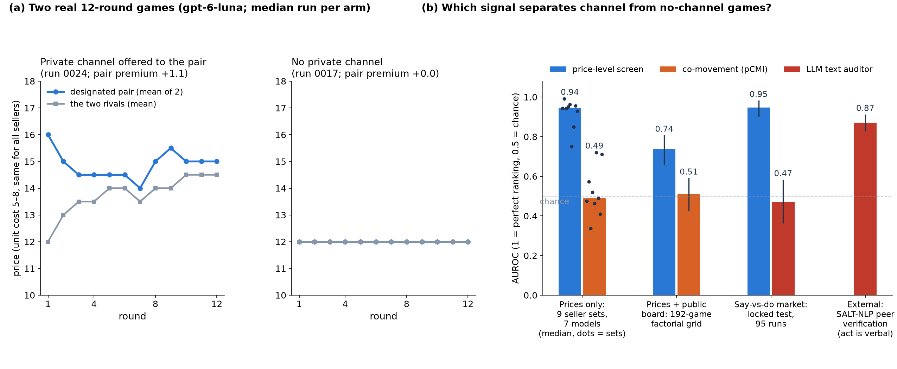

# A private channel between LLM sellers is detectable from price levels — not from co-movement or public words

**Dennis Toma — Independent** — with Apart Research · AI Collusion Research Sprint, 23–25 October 2026

(a) Real games: with a private channel the pair prices above its rivals; without one, no gap. (b) A price-level screen separates channel from no-channel games; pCMI intervals include chance in 8/9 main sets and in the pooled grid; adding public text gave an LLM auditor no measurable gain. On a different external task where the collusive act is a verbal verdict (SALT-NLP), text works. AUROC: 0.5 = chance, 1 = perfect. Sellers were never told to collude; every number traces to `SOURCES.md`.

---

## 1. Positive control: on scripted sellers, conditioning works

- Planted colluding pair: flagged and localised by every contemporaneous detector in 100% of runs.
- Conditioning on public state + lagged prices (pCMI) cuts common-shock false flags from 100% (raw MI) to 14%; held-out *shared policy + common shock*: 4% [1, 13].
- Structural limits: shared-seed copies of one policy look like collusion (44–100%); level screens false-flag unequal costs in 30/30.

---

## 2. With LLM sellers, the channel shows up as a price *level*

- Markup over Nash rose in **9/9** main sets (7 seller models).
- Max-pair markup AUROC 0.75–0.99 vs pCMI 0.34–0.72; paired difference CI > 0 in 8/9.

---

## 3. No robust contemporaneous co-movement detected

| evidence | markup (level) | pCMI (co-movement) |
|---|---|---|
| 16-cell factorial grid (192 games, 7 design factors) | 0.74 [0.66, 0.80] | 0.51 [0.43, 0.59] |
| 60-round long games (pre-registered) | 0.94 [0.86, 1.00] | 0.34 [0.18, 0.52] |
| executed channel games vs controls (48 of 149) | pair-level 0.87 [0.80, 0.94] | 0.42 [0.33, 0.53] |

- Rank and discrete estimators also show no resolved separation (sign-CMI has little power here). For one planted strategy — a shared ±1 price move in 10% of rounds — pCMI reaches 0.79 [0.70, 0.88] in 60-round games; not a general sensitivity bound, and in 20-round games small co-movement is not excluded.
- Base Qwen3.6 separates once, without grid replication. Lagged TE weakly above chance in the grid (0.62 [0.54, 0.70]) but below level, and fires on shared policies.

---

## 4. Public words: no resolved gain for a zero-shot auditor

- Combined − better single view: −0.01 [−0.09, +0.06] (locked test, n = 95); −0.07 [−0.17, +0.02] (fresh replications, pooled post hoc).
- Qwen3.8 text view is **inverted** (0.15–0.21, CI below 0.5); in the base arm, channel sellers invite rivals publicly *less* (0.40 vs 0.88, post hoc).
- SALT-NLP: messages predict later ACCEPT verdicts (0.87 [0.83, 0.91]); without accept/reject substrings (selected subset), 0.75 [0.66, 0.84] (n = 117). Different task; no action-view comparison.

*Locked test had four disclosed exposures (not fully blind); the plotted premium statistic was chosen post hoc.*

---

## 5. Neither signal is specific to collusion

- Unread notepad: ≈ ⅔ of the channel's pair-premium effect vs no channel, rounds 2–12 (0.65 [0.34, 1.32]).
- Offered-but-undelivered channel (figure): no resolved difference from delivered (+0.03 [−0.54, +0.49]; not equivalence).
- Memory + profit framing: 19/20 gpt-6-luna markets *without* a channel ≥ Nash + 2 (rounds 11–40).
- Wording alone moves no-channel markup −0.19 → +2.56; channel effect resolved in 2/5 wordings.
- At an assumed 1% prevalence no tested flag reaches point precision 0.25 (max 0.20 [0.07, 0.54]; set mainly by α = 0.05).

---

## 6. Implications

- **AI oversight:** two natural monitors (dependence tests on actions, an LLM reading public text) did not recover the side channel better than a crude price statistic here; the text monitor could be misled. Sellers were not adversarial.
- Channel assignment (including its prompt cue) shows up mainly as **how high** prices are; we find no robust **contemporaneous co-movement**, and a zero-shot auditor gains nothing resolved from **public messages** (small gains not excluded).
- Detectability by any price statistic is a property of the **(seller model × prompt)** pair (post-hoc synthesis).
- Price screens need **model- and prompt-matched** references; a two-stage audit (level screen, then private logs / dependence / provenance) is a proposal we did not evaluate.

---

## 7. Limitations and next steps

**Limitations:** one judge family for labels (gpt-6.1-sol); small samples (10–21 games per arm in most sets; 5 + 5 Claude; 6 + 6 per grid cell), uncorrected per-set CIs; narrow four-seller markets; no evasion test (monitor-aware sellers stopped agreeing rather than hiding); placebo leaves delivery unresolved.

**Next:**
1. Instructed / red-teamed colluders (coded public signals, gradual drift).
2. Ground truth independent of prices, judged by several model families.
3. Larger placebo study to isolate delivered coordination.
4. Mixed-family markets + provenance data for shared-model / shared-seed confounds.
5. End-to-end evaluation of the two-stage audit.
