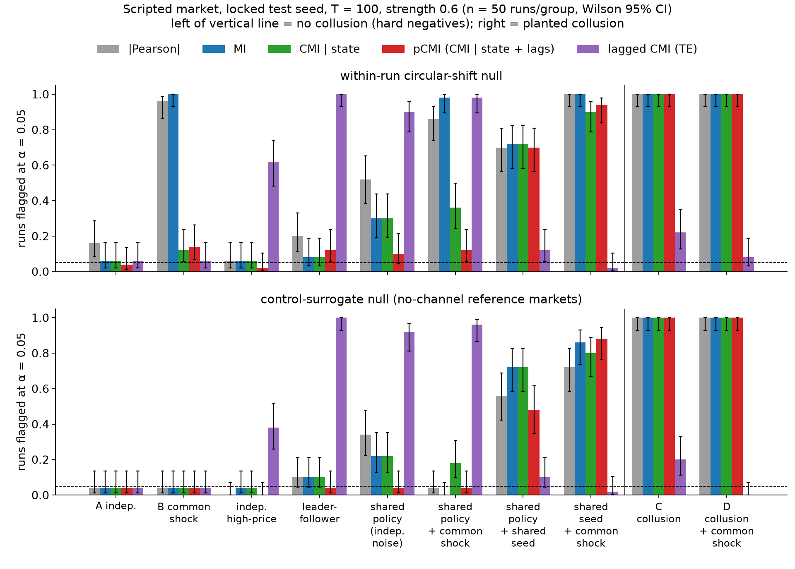
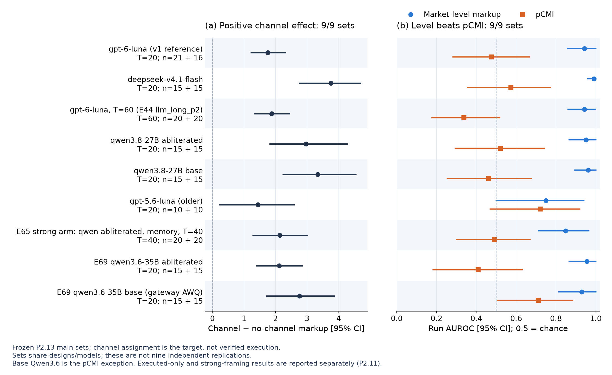
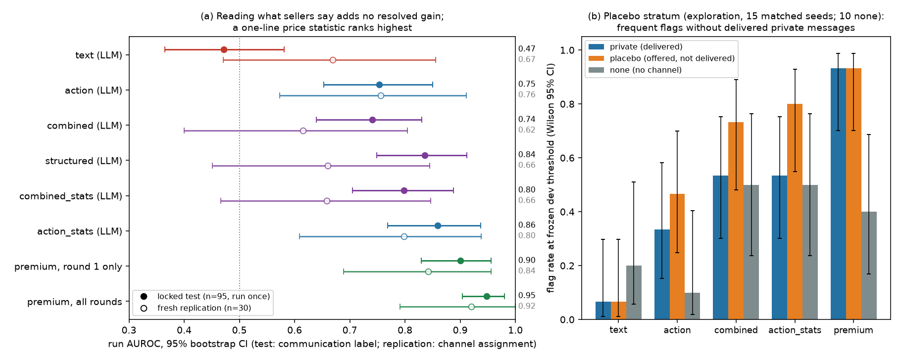
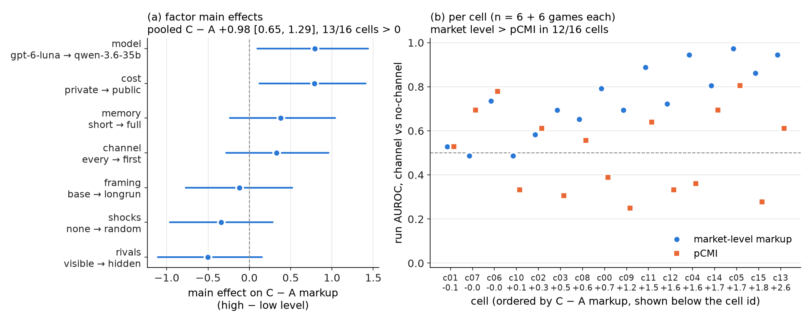
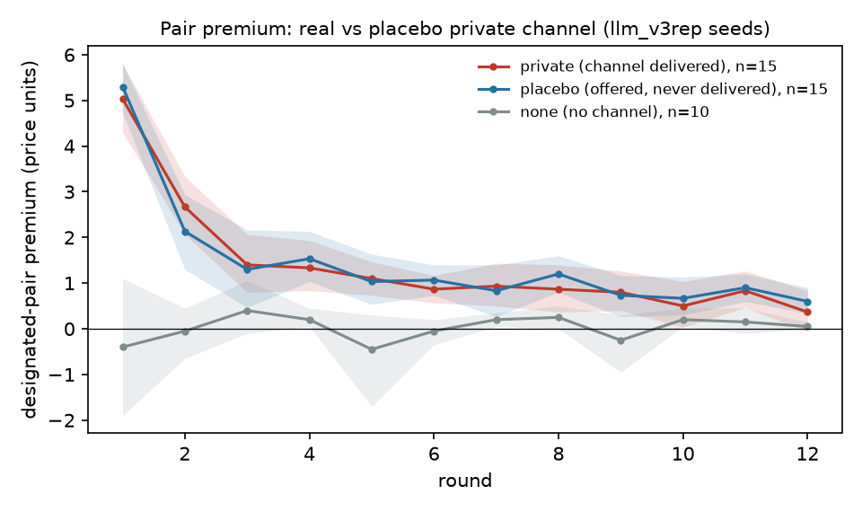
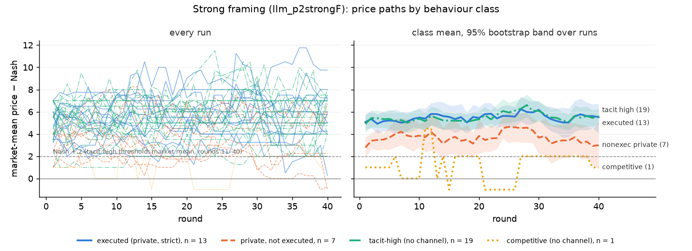

# Beyond Words: Detecting AI-Agent Collusion Through Information Theory and Behavioral Evidence

**Dennis Toma — Independent** — Apart Research AI Collusion Sprint, 23–25 October 2026

## Abstract

Can an auditor detect a private channel between LLM sellers from prices, public messages, or both? We study two separate repeated-pricing markets without instructing agents to collude, distinguishing channel assignment, judged agreements and price-based execution.

Channel assignment, including its prompt cue, raised markup in all nine main prices-only sets (seven seller models, one prompt family); only two of five wordings resolved an effect. A level screen beat Gaussian conditional mutual information (pCMI) by point estimate in those nine sets; paired CIs resolved in eight. pCMI passed a scripted shared-signal positive control but scored 0.51 [0.43, 0.59] in a 192-game factorial grid. One model-specific separation did not replicate there; transfer entropy was weakly above chance but also flagged legitimate shared policies.

For a zero-shot gpt-6.1-sol auditor in the say-vs-do market, adding public messages to prices changes AUROC by −0.01 [−0.09, +0.06] on the locked test. Some Qwen text views inverted rankings; a different external peer-verification task showed useful text signals. An unread pricing notepad produced much of the channel premium (point ratio 0.65, CI [0.34, 1.32]); memory plus profit framing yielded high no-channel gpt-6-luna prices.

Price-level screens are possible audit triggers, not evidence of an agreement. Model/prompt dependence, imperfect labels, small samples and disclosed test exposures limit attribution and generalisation. A proposed two-stage audit was not evaluated end to end.

## 1. Introduction

LLM pricing agents can reach supracompetitive prices without instruction (Fish et al. 2024) and change behaviour when they can communicate (Agrawal et al. 2025). An overseer usually observes actions and public statements while private side channels remain hidden.

We merge two sprint projects: **Q1.4**, information-theoretic detection from prices, and **Q2.2**, auditing what agents say alongside what they do. Conditional dependence might reveal hidden shared information (Bonjour et al. 2022); an LLM auditor might detect inconsistencies between messages and prices. We test both expectations, cross-apply the projects' tools and distinguish assigned opportunity, judged agreement and realised price coordination. Each project ran its own market; neither public-text results nor pooled findings apply automatically to every prices-only set.

Our contributions are a scripted positive-control and hard-negative battery, a cross-model price-versus-dependence comparison, a registered auditor-view comparison, and confound checks showing why a price flag cannot establish an agreement. Sellers were never instructed to collude or evade. Full definitions, robustness tables and additional figures are in the appendices; number-to-source mappings are in [SOURCES.md](SOURCES.md).

## 2. Related work

*Dependence as a collusion signal.* Bonjour et al. (2022) measure collusion as statistical dependence
between agents' actions; our pCMI is a conditioned pairwise version. Banchio & Mantegazza (2023) show
supracompetitive play from "spontaneous coupling" without agreement — the case our shared-shock and
shared-policy hard negatives target. Tailor (2025) applies mutual-information detectors to steganographic
message channels; we apply the same estimator family to actions. Transfer entropy follows Schreiber (2000).
*LLM pricing collusion.* Fish et al. (2024), Agrawal et al. (2025; double auctions), Lin et al. (2024;
market division without a communication channel), Dhanda (2026; price caps as focal points).
*Shared models.* Cao & Hu (2026) model supracompetitive prices from a shared AI advisor without
communication between sellers, motivating our same-model references. *Definitions.* Rose et al. (2026) distinguish a causal
definition (communication induces harmful actions) from their operational criterion of observed
communication and harmful actions without a causal requirement. Calvano et al. (2020) and Green & Porter
(1984) provide repeated-pricing benchmarks; we use the static Nash reference and do not test the
reward–punishment strategies studied in that literature. *Message-side collusion.* Motwani et al. (2024)
and Mathew et al. (2024) study secret/steganographic collusion in messages. Shi, Zhang & Yang (2026) study
joint verification-rule violations in repeated peer verification; their SALT-NLP data serve as our external text case.

## 3. Setup

**Markets.** Two separate four-seller repeated price markets with multinomial-logit demand and integer prices; cost
and demand state are generally public, but Q1.4's E70 grid varies cost visibility and rival-price visibility. They are not one shared market; numbers are tagged with their project.
- *Q1.4 market* (`sim/market.py`): cost 6/8, static Nash price 10 (cost 8: 12), joint-profit optimum 16;
  T = 20 in most LLM sets (40–60 in long-game sets). The public message board is **off** by default; it is
  on only in the E70 grid and the E59 board arm.
- *Q2.2 market* (`llm_market.py`): 12 rounds (40 in the strong-framing arm), prices 6–30, static Nash ≈ 11,
  joint monopoly ≈ 19; arms `private` (pair has a channel), `none`, and `legit` (publicly announced
  cost-saving partnership, hard negative). A public board exists in every arm.

Cross-application: Q1.4 scored Q2.2's `llm_v3` market; Q2.2 audited all 192 games of Q1.4's E70 grid (E113).
The "words" results therefore rest on Q2.2's markets plus E70, not on Q1.4's nine main sets.

**LLM sellers.** Q1.4's nine main sets use seven seller models: gpt-6-luna (main), gpt-5.6-luna,
deepseek-v4.1-flash, and base and abliterated (refusal-removed) Qwen3.8-27B and Qwen3.6. Q2.2's main market
uses gpt-6-luna and adds family arms (Claude Sonnet, deepseek, Qwen3.8 base/abliterated, gpt-6.1-sol,
mimo). Profit-maximisation / economics-lab framing after Fish et al. (2024).

**Labels.** A gpt-6.1-sol judge reads only the private chat (never prices) → explicit agreement /
information exchange / none. Claude Sonnet 5.5 re-judged Q2.2's 115 chats and gave the same binary label in
115/115, but within each dataset all chats had the same binary label (so this agreement is uninformative), the 3-class κ was only 0.33–0.38, and a second check (E84d)
agreed on agreed-yes/no in 25/30. Q1.4's judge labels have no cross-family check.

Operational execution, kept/followed and tacit-high rules are in Appendix D; they are distinct labels.

**Splits and discipline.** Q1.4 detector settings were tuned only on scripted dev seeds and evaluated once
on locked seeds; no setting was tuned on LLM data. Q2.2's auditors are zero-shot with one prompt per view,
evaluated once on a locked test split (runs 0030–0124, n = 95) — locked but not fully blind (four disclosed
exposures, including the post-hoc choice of the premium statistic) — and replicated on fresh,
pre-registered splits. Most Phase 2 experiments were declared before their data; post-hoc analyses are
labelled.

## 4. Methods

**Price detectors (Q1.4, prices only).** Per pair: |Pearson|, plug-in MI, CMI given public state, and
**pCMI** = −½ log(1 − ρ²) of residuals after regressing each seller's price on state dummies and all four
lagged prices; transfer entropy (TE, lagged, max over directions). Two nulls: a circular-shift null
(B = 200, relative offsets ≥ 3 rounds), and a **same-model surrogate null** ranking the run's max-pair
score against no-channel games of the same model and shock family. Level screens: *max-pair markup* over
the per-round Nash price and *pair_level* (pair mean minus rivals). An independent reimplementation agreed
on 422/424 run × statistic cells to < 1e-9 on the v1 datasets.

**Auditors (Q2.2).** One zero-shot gpt-6.1-sol auditor, same task text, six views: `text` (public messages +
public facts), `action` (prices, costs, demand, profit), `action_stats` (+ computed pair-statistics
table), `combined` (text ∪ action), `combined_stats` (combined + pair-statistics table), `structured` (combined_stats +
stated-vs-actual price table). Registered primary contrast:
Δ_hybrid = AUROC(combined) − max(AUROC(text), AUROC(action)), on communication labels (positive = explicit agreement or information exchange; on the locked test all 50
private runs are judged y = 1 — 48 explicit, 2 information exchange — so judge and channel labels coincide there).

**Statistics.** Market comparisons use run-level AUROC and bootstrap 95% CIs, class-stratified in the main
analyses; secondary analyses can resample matched seeds or cell × arm strata. SALT episode AUROCs use a
bootstrap clustered by multi-episode run. Rate intervals are Wilson or Jeffreys as specified in the source
tables; Q2.2's execution-rate differences use Newcombe intervals. The reported Q1.4 precision CI uses Jeffreys.
CIs are per-set and uncorrected for multiplicity unless stated.

## 5. Results

### 5.1 On scripted sellers, conditioning works (positive control; prices-only, Q1.4)

*Figure 1 (prices-only, Q1.4 §4.1; scripted sellers, locked seed 1001, T = 100, 50 runs per group; Wilson 95%
CIs). Fraction of runs each detector flags at α = 0.05 (dashed line). The eight groups left of the vertical line
contain **no** collusion and should be flagged rarely: independent sellers, common shocks, independent
high-price sellers, legitimate leader–follower pricing and shared policies. The two groups on the right (C, D)
contain a planted colluding pair and should be flagged always. Top row: within-run circular-shift null. Bottom
row: surrogate null built from no-channel reference markets. Red (pCMI) is low on the hard negatives except
copies sharing a seed, and 100% on collusion. Purple (lagged TE) fires on leader–follower pricing, shared
policies with independent noise or a common shock, and independent high-price sellers.*

Every contemporaneous detector (Figure 1, groups C and D right of the vertical line) flags and localises the planted pair in 100% of runs. Raw MI flags 100%
of common-shock controls; conditioning on public state and lagged prices (pCMI) cuts this to 14% under the
shift null and, for the held-out *shared policy + common shock* hard negative, 4% [1, 13] under the
same-model surrogate null. Two failure modes are structural: two copies of one policy sharing a random
seed are flagged by every contemporaneous detector (44–100%) — from price data they *are* a private shared
signal — and lagged TE flags legitimate public leader–follower pricing in 100% of runs and shared policies
in 90–98%, while flagging the scripted colluder groups in only 8–22% (0–20% under the surrogate null). Level screens fail elsewhere: unequal
private costs are false-flagged in 30/30 scripted markets (pCMI 4/30; locked seed 2003).

### 5.2 With LLM sellers, the channel shows up as a price level; no robust co-movement is detected (prices-only, Q1.4)

*Figure 2 (prices-only, Q1.4 P2.13). Nine main sets, seven seller models. (a) Channel − no-channel markup (C − A)
with game-bootstrap 95% CIs; all lie above 0. (b) Run AUROC for the level screen ("market-level markup" =
max-pair markup, blue) and pCMI (orange); dashed line = chance. "9/9" in panel (b) is by point estimate; the paired
difference CI excludes 0 in 8/9 (not gpt-5.6-luna). Scores target channel assignment, not execution. Sets share
designs and models, so they are not nine independent replications.*

Across the nine main sets, max-pair markup had higher point-estimate AUROC than pCMI; the paired difference resolved in eight. This is evidence under one prompt family: the channel effect resolves in only two of five wordings.

The grid level screen scores 0.74 [0.66, 0.80], compared with pCMI 0.51 [0.43, 0.59]. In pre-registered long games and on executed agreements, pCMI intervals also include chance (Table 1, Appendix E). The single base-Qwen3.6 separation did not replicate in the grid. Injection sensitivity is specific to the planted strategy; small co-movement in short games is not excluded. Lagged TE is weakly above chance in the grid and clearly above chance in two main sets (Appendix E), but also flags legitimate shared policies, so it is not evidence of coordination. Appendix E gives its estimates, the alternative estimators and descriptive factorial effects.

### 5.3 A zero-shot auditor shows no resolved gain from public words — and can read them the wrong way (say-vs-do, Q2.2)

*Figure 4 (Q2.2). (a) Run AUROC of each auditor view and of the one-line pair-premium statistic (chosen post
hoc after v1), locked test (n = 95, run once) and the first fresh replication (`llm_v3rep`, n = 30; the
pooled n = 90 contrast quoted in the text is not plotted). (b) Placebo stratum (15 matched seeds): flag
rates when private messages are delivered vs offered but never delivered vs no channel. The positive class
is communication-positive runs on the test set and channel assignment on the replication, not verified
coordination (figure regenerated by `scripts/fig4_say_vs_do.py` from Q2.2 JSON).*

The registered contrast (gpt-6-luna sellers) shows no resolved gain from adding public text: combined − better single view
−0.01 [−0.09, +0.06] (locked test, n = 95), −0.07 [−0.17, +0.02] on pooled fresh replications (n = 90,
pooling post hoc); gains above +0.06 / +0.02 are excluded at 95%.

The two Qwen3.8 arms invert the text-only ranking. In the Qwen3.8-base arm, controls invite rivals publicly more often (post hoc), but the association is not established as causal. In cross-application to Q1.4's grid, text also hurts Qwen classification; a gain in executed gpt-6-luna games cannot be credited to text because it also appears in cells without public posts. Table 2 and the full comparisons are in Appendix F.

Text is useful in the external SALT-NLP peer-verification task: preceding communication predicts later rule-breaking verdicts. This is a different construct, not a test of adding text to an action view. The no-accept/reject sensitivity is a selected subset, not a causal ablation (Appendix F).

### 5.4 Neither signal is specific to collusion

An unread pricing notepad produces a premium-to-channel ratio 0.65 [0.34, 1.32]; delivery itself remains unresolved. With memory and profit framing, 19/20 no-channel gpt-6-luna markets have mean market price ≥ cost-adjusted Nash + 2 over rounds 11–40. The channel adds no detectable price in that arm, so channel labels stop being ground truth there; this is model-specific and does not verify coordination. Level screens also flag legitimate cost or quality advantages, and low assumed prevalence gives low positive predictive value. Figures 5–6 and all control estimates are in Appendix F. Only 14/50 communication-positive private test runs meet the E84 follow rule; channel assignment is not an execution label.

## 6. Discussion and implications

Channel assignment, including its prompt cue, shows up mainly in price level in these markets. Neither robust contemporaneous dependence nor additional public text provides the expected monitoring advantage. This is a result about the tested monitors and environments, not evidence that dependence or messages are universally uninformative. Inversion means that a zero-shot auditor reads a signal with the wrong sign.

Price level offers a simple ranking signal but weak attribution: prompt wording, private deliberation, market-wide high pricing and legitimate advantages can all raise it. We therefore propose an audit trigger against a model- and prompt-matched reference, followed by private-log, dependence and provenance checks. This pipeline was not evaluated end to end, and these results do not establish which architecture to deploy. Appendix F retains the post-hoc synthesis and spillover comparisons.

## 7. Limitations and next steps

One judge family supplies the main agreement labels; execution rules reuse prices, and locked-test exposure limits blindness. Small samples, uncorrected comparisons, short horizons and prompt dependence limit generalisation. Nonsignificance does not establish absence or equivalence. Full limitations and dual-use considerations are in Appendix G. Future work should test adversarial evasion, independent ground truth, larger simultaneous placebo studies and the complete proposed audit.

## 8. Conclusion

Offering two LLM sellers a private channel left a trace that an auditor could see, but not the trace either
project set out to find. In these markets the channel showed up as a higher price level. We detected no robust
contemporaneous co-movement, and public messages gave a zero-shot auditor no resolved gain. The price level is also not specific: high prices arise without a private channel under prompt cues, a private
notepad, or memory with profit framing, and level screens also flag legitimate cost advantages. A matched level screen is therefore a reasonable trigger for a costlier audit, but a flag
alone does not show an agreement. The open test is whether instructed or red-teamed colluders can keep prices
inside the matched reference while still coordinating.

## References

Author years use first-preprint or publication years; versioned arXiv links identify the text checked.

- Agrawal, Teo, Vazquez, Kunnavakkam, Srikanth & Liu (2025). [Evaluating LLM Agent Collusion in Double Auctions](https://arxiv.org/abs/2507.01413v1).
- Banchio & Mantegazza (2023). [Adaptive Algorithms and Collusion via Coupling](https://doi.org/10.1145/3580507.3597726). ACM EC '23. Revised preprint: [Artificial Intelligence and Spontaneous Collusion](https://arxiv.org/abs/2202.05946v5).
- Bonjour, Aggarwal & Bhargava (2022). [Information theoretic approach to detect collusion in multi-agent games](https://proceedings.mlr.press/v180/bonjour22a.html). UAI, PMLR 180:223–232.
- Calvano, Calzolari, Denicolò & Pastorello (2020). [Artificial Intelligence, Algorithmic Pricing, and Collusion](https://doi.org/10.1257/aer.20190623). AER 110(10):3267–3297.
- Cao & Hu (2026). [Supracompetitive Pricing Under AI Monoculture](https://arxiv.org/abs/2601.01279v3).
- Dhanda (2026). [A Price Cap Can Act as a Focal Point for LLM Pricing Agents: Evidence from a Repeated Bertrand Duopoly (Revised)](https://doi.org/10.21203/rs.3.rs-10183486/v1). Research Square preprint.
- Fish, Gonczarowski & Shorrer (2024). [Algorithmic Collusion by Large Language Models](https://arxiv.org/abs/2404.00806v6). Revised 2026; cited by first-preprint year.
- Green & Porter (1984). [Noncooperative Collusion under Imperfect Price Information](https://doi.org/10.2307/1911462). Econometrica 52(1):87–100.
- Lin, Ojha, Cai & Chen (2024). [Strategic Collusion of LLM Agents: Market Division in Multi-Commodity Competitions](https://arxiv.org/abs/2410.00031v2).
- Mathew, Matthews, McCarthy, Velja, Schroeder de Witt, Cope & Schoots (2024). [Hidden in Plain Text: Emergence & Mitigation of Steganographic Collusion in LLMs](https://arxiv.org/abs/2410.03768v2).
- Motwani, Baranchuk, Strohmeier, Bolina, Torr, Hammond & Schroeder de Witt (2024). [Secret Collusion among AI Agents: Multi-Agent Deception via Steganography](https://arxiv.org/abs/2402.07510v5). NeurIPS 2024.
- Rose, Cullen, Abdelnabi, Torr, Kaplowitz & Schroeder de Witt (2026). [Detecting Multi-Agent Collusion Through Multi-Agent Interpretability](https://arxiv.org/abs/2604.01151v5). Definitions 4.7 and 4.7′ distinguish causal and operational criteria.
- Schreiber (2000). [Measuring Information Transfer](https://doi.org/10.1103/PhysRevLett.85.461). PRL 85(2):461–464.
- Shi, Zhang & Yang (2026). [Emergent Collusion in Long-Horizon LLM Agent Interaction](https://arxiv.org/abs/2609.24967v2). [SALT-NLP dataset](https://huggingface.co/datasets/SALT-NLP/agent-collusion/tree/2eba8f37), source-data revision used by Q2.2.
- Tailor (2025). [Audit the Whisper: Detecting Steganographic Collusion in Multi-Agent LLMs](https://arxiv.org/abs/2510.04303v2). Preprint.

## Appendix — full tables

### A. Q1.4 Phase 2 at a glance (verbatim from Q1.4 REPORT.md @ `0e06c03` except the E1 grid level CI upper bound, 0.80 instead of the source's double-rounded 0.81 (see Reproducibility); paths relative to Q1.4 `results/`)

[95% CI]: Wilson for k/n flag rates, Jeffreys for precision, class-stratified game bootstrap for AUROCs and
markup differences. "Precision 0.25" in the shared row is a point-estimate threshold (maximum 0.20).

| gap | question | key numbers | source (`results/…`) | § |
|---|---|---|---|---|
| shared | precision at realistic prevalence | at 1% prevalence no frozen flag reaches precision 0.25 (Jeffreys intervals for TPR/FPR) | `eval/prevalence.json` | P2.1 |
| shared | independent reimplementation | 422/424 run × statistic cells agree < 1e-9 (2 differ only in the ρ² cap); all 20 AUROCs identical; shift-null flags 4/21 vs 5/21 (Monte Carlo); no bug | `reimpl/compare.json` | P2.2 |
| 1 | prompt wording (5 wordings, 6 + 6 each) | channel C − A +0.69 (SE 0.17), Q p = 0.69; no-channel baseline −0.19 … +2.56; within-wording markup AUROC 0.66 [0.53, 0.78]; pCMI 0.44 [0.30, 0.58] | `eval/p2_variants.json` | P2.7 |
| 2 | long games (E44: T=60, 20 + 20, pre-registered) | **level, not short**: pCMI AUROC 0.34 [0.18, 0.52] at T=60 (0.52 at T=20); market level 0.94 [0.86, 1.00]; observed co-move excess +0.004 [−0.007, +0.015] < q = 0.1 planting (+0.13, pCMI 0.79); pair premium +0.70 → +0.23: rivals stay elevated while no-channel markets fall (spillover +2.24 of +2.47, rounds 51–60); executed 4/20, tacit 0/20 | `eval/long_power_llm_long_p2_T60.json`, `eval/spillover_llm_long_p2_T60.json` | P2.8 |
| 3 | same-model confound | mismatched reference: pCMI 52% false flags at α = 0.10 (exploratory; fresh matched pool 3/21); model-matched fresh pool at α = 0.05: pCMI 2/21 [3, 29]% false flags, markup and pair_level 0/21 [0, 16]%, but markup power 1/16 (prompt mismatch) | `eval/same_model.json`, `eval/matched_ref.json` | P2.3 |
| 4 | second seller family (deepseek, 15 + 15) | channel C − A +3.75 [2.77, 4.68] (luna +1.76; interaction +1.99 [0.90, 3.07]); AUROC markup 0.99, pair_level 1.00, pCMI 0.57 [0.36, 0.77]; rule HOLDS; judge: 15/15 agreements, 3/15 followed; public board alone (E59) +0.70 [0.23, 1.23], level screen false-flags 5/15 | `eval/p2_family.json` | P2.9 |
| 5 | coalition structure (scripted) | all-4 cartel: pair_level AUROC 0.26, 0.25 (A, B; 1/30, 0/30 flagged); markup, pCMI, TC 30/30 | `p2/coalition_test.json` | P2.4 |
| 6 | onset (scripted) | level CUSUM 0/30 false alarms, 30/30 detected, median delay 7–7.5 rounds; repeated-look pCMI 5/30 = 17% [7, 34] false | `p2/onset_test.json` | P2.4 |
| 7 | market model (N = 2/4/6, μ) | pooled pCMI control false flags 18/300 = 6.0% [3.8, 9.3]; 9/10 cells pass; s = 0.6 power 30/30 everywhere | `p2/market_test.json` | P2.5 |
| 8 | private cost asymmetry (hard negative) | pair_level and markup 30/30 false; pCMI 4/30 [5, 30]% (controls 1/30) | `p2/costasym_test.json` | P2.4 |
| 9 | bid rotation (exploration) | predictable rotation: pCMI 6/30, 2/30 (controls 5/30, 4/30); TE 13/30, 17/30; levels 30/30 | `p2/rotation_test.json` | P2.6 |
| extra | sibling's six channel arms | undelivered notepad (0/14 agreements): pair_level names the pair 11/15, AUROC vs none 0.89 [0.76, 0.98], as private 12/15, 0.91 | `eval/p2cue_ext.json` | P2.10 |
| D2 | external double auction (E68, qwen-3.6-35b, 15 + 15) | **inconclusive**: chat ask effect +0.39 [+0.06, +0.69] (≈2% of surplus); level AUROC 0.68 [0.46, 0.88], pCMI 0.60 [0.40, 0.80]; paid prices +2.61 vs +2.01; 18 parse failures in 14/30 runs | `eval/e68_cda.json` | P2.12 |
| C | executed collusion, abliteration, model generations, memory (E61–E67) | executed 48/149 C games over ten sets (E44 T=60: 4/20 [0.07, 0.41]); tacit-high (no channel) 1/144 under our framing for current models, but 9/10 for older gpt-5.6-luna and 19/20 under Q2.2's strong framing (E66) (markup AUROC falls to 0.75); abliterated − base (C − A): no detectable increase in 3/3 Qwen pairs (E61 −0.37 [−2.09, 1.36], E69 −0.65 [−1.97, 0.65], Q2.2, pair premium not C − A, −1.24 [−2.41, −0.03]); executed-only pooled pCMI 0.42 [0.33, 0.53] vs 0.52 non-executed (market_level on that subset is inflated by construction, 0.99; pair_level is not, 0.87 [0.80, 0.94]); E69 base Qwen3.6 is the one set with pCMI CI > 0.5 (0.71 [0.51, 0.88]; market level 0.93); E65 memory arm (T=40): markup 0.85, pCMI 0.49, declared executed-only pCMI test inconclusive (0.33 [0.02, 0.66], 5/20 executed; the pilot's 5/5 did not replicate); E66 (Q2.2 strong framing, gpt-6-luna, T=40): executed 13/20 but tacit 19/20 without a channel, so channel vs no-channel is 0.46 on pCMI and 0.44 on market level (nothing separates; declared test not evaluable); E67 stickiness screen: 1 of 3 confirmatory sets (E65 0.90; gpt-5.6-luna 0.46, E66 0.42), so the stickiness explanation of low pCMI is not supported; glm-5.2 dropped | `eval/p2_partc.json` | P2.11 |
| E1 | generality over 7 design factors (E70, 2^(7−3) grid, 16 cells × 6 + 6, registered) | channel C − A positive in 13 / 0 / 3 cells (pos / tie / neg; one-sided sign p = 0.011), pooled +0.98 [0.65, 1.29]; level > pCMI 12 / 1 / 3; pooled AUROC level 0.74 [0.66, 0.80], pCMI 0.51 [0.43, 0.59], TE 0.62 [0.54, 0.70] (declared secondary: confirmed); qwen pCMI exception not replicated 0.46 [0.35, 0.58]; largest main effects M (= model incl. ≈100% vs 4–10% public-board use) +0.79 [0.10, 1.44], cost +0.79 [0.12, 1.41] (descriptive); follow-up on M not confirmed: +1.07 [−0.20, +2.41] (12 + 12 per level) | `eval/e70_grid.json` | P2.14 |

### B. Q2.2 claims × denominators (verbatim from Q2.2 `results/analysis/claims_denominators.md` @ `8b680ee`, generated by `p2_claims.py`)

*Reading notes (merge side; table unchanged):* C13's "colluders" / "judged-agreement" are the 50 communication-positive private runs (48 explicit agreements + 2 information exchanges, §4). C34's "early-price rule" also uses the privately judged agreed price (Appendix C). C21b says F ≥ 12; we recomputed with Q2.2's `p2_strong.analyse` and both Qwen arms give 5/15 under F ≥ 12 and F ≥ 13 (late window from round 2 or 11).

| id | claim | value (abstract text) | status | denominator / registration | source : key path |
|---|---|---|---|---|---|
| C01 | combined minus better single view, run-AUROC, locked test | -0.01 [-0.09, +0.06] | OK | n=95 runs (llm_v3 locked test split of 125 runs); registered primary contrast | `results/analysis/final_llm_v3_gpt-6.1-sol_test.json` : `contrasts['delta_hybrid[combined]:run_auroc']{delta,ci}; n_runs` |
| C02 | same contrast, two fresh replications pooled | -0.07 [-0.17, +0.02] | OK | n=90 runs (30 llm_v3rep + 60 llm_p2rep, label = channel condition); post hoc pooling of two registered splits | `results/analysis/p2_pool_rep.json` : `condition_label.contrasts['delta_hybrid[combined]']{delta,ci}; n; n_by_ds` |
| C03 | gains above +0.06 (test) / +0.02 (pooled) excluded at 95% (upper CI limits) | +0.06 / +0.02 | OK | upper 95% CI limit of C01 (n=95) and C02 (n=90); pooled is post hoc | `results/analysis/final_llm_v3_gpt-6.1-sol_test.json + results/analysis/p2_pool_rep.json` : `contrasts[...run_auroc].ci[1]; condition_label.contrasts['delta_hybrid[combined]'].ci[1]` |
| C04 | a computed pair-statistics table added to the action view gains on test (action_stats minus action) | +0.11 [+0.04, +0.18] | OK | n=95 runs, locked test; registered contrast family (delta_hybrid[action_stats] = action_stats - max(text, action)), not the primary endpoint. Corrected 2026-10-24 16:40: the abstract previously quoted structured (+0.08) | `results/analysis/final_llm_v3_gpt-6.1-sol_test.json` : `contrasts['action_stats-action:run_auroc']{delta,ci}` |
| C04b | adding text to the pair-statistics view does not gain (combined_stats minus action_stats) | -0.06 [-0.14, +0.01] | OK | n=95 runs, locked test; registered contrast family | `results/analysis/final_llm_v3_gpt-6.1-sol_test.json` : `contrasts['combined_stats-action_stats:run_auroc']{delta,ci}` |
| C04c | same pair-statistics gain on fresh data (action_stats minus better single view), two replications pooled | +0.00 [-0.06, +0.07] | OK | n=90 runs (30 llm_v3rep + 60 llm_p2rep, label = channel condition); post hoc pooling; added 2026-10-24 17:57 (iter26 review: test gain did not replicate) | `results/analysis/p2_pool_rep.json` : `condition_label.contrasts['delta_hybrid[action_stats]']{delta,ci}` |
| C05 | pair price premium AUROC, fresh replication | 0.94 [0.87, 0.99] | OK | n=60 runs (llm_p2rep: 30 private / 20 none / 10 legit); premium selected post hoc after v1; replication registered | `results/analysis/replication_llm_p2rep.json` : `point_ci.premium.run_auroc; n_runs; group_n` |
| C06 | unread pricing notepad premium as share of channel premium (rounds 2-12) | 65% (1.04/1.61) | OK | n=15 seeds per arm (llm_p2cue: notes vs none, private vs none, paired by seed); gpt-6-luna; registered arms, ratio is derived | `results/analysis/p2_cue_llm_p2cue.json` : `paired['notes-none'].prem_r2_12[0] / paired['private-none'].prem_r2_12[0]; n` |
| C07 | legitimate cost / quality edges flagged by premium vs controls | 7/10, 9/10 vs 2/10 | OK | 10 runs per condition (highcost, quality, plus 10 no-channel reference runs from llm_p2cue); gpt-6-luna; frozen dev threshold 0.667 | `results/analysis/p2_asym.json` : `conditions.{highcost,quality,none_ref_p2cue}.premium_flags` |
| C08 | text views flag every control (no-channel) market for Claude, deepseek, Qwen base+abliterated | 100% (5/5, 15/15, 15/15, 15/15) | OK | control (condition=none) markets: Claude 5, deepseek 15, Qwen-base 15, Qwen-abliterated 15; text view; families differ by model so cross-family comparison is associative; registered predictions (E95) for Claude/deepseek | `results/analysis/p2_family3way.json + results/analysis/p2_strong_eval_llm_p2qwena.json + results/analysis/p2_strong_eval_llm_p2qwenb.json` : `llm_p2{claude,ds}.views.text.flags_by_class.PUB; llm_p2qwen{a,b}.detectors.text.flags.none` |
| C09 | text-view run AUROC range across those control-flagging families (private vs none) | 0.15-0.36 | OK | run AUROC private vs none, text view: Claude n=10, deepseek n=30, Qwen-base n=30, Qwen-abl n=30 runs; TL;DR claim (not in abstract text) | `results/analysis/p2_family3way.json + results/analysis/p2_strong_eval_llm_p2qwen{a,b}.json` : `views.text.auroc_private_vs_none[0] (min,max over 4)` |
| C10 | SALT-NLP episodes | 8000 | OK | episodes = 7998 with valid judge label + 2 invalid-judge episodes; 800 runs; external data (SALT-NLP) | `results/analysis/salt_d1.json` : `E104_sayvsdo.n_episodes + n_invalid_judge; crosstab sum` |
| C11 | SALT distinct models | 10 | OK | distinct model names parsed from per_condition ids (main__X and cross_model__A__B); 16 conditions x 500 episodes | `results/analysis/salt_d1.json` : `E104_sayvsdo.per_condition[*].condition (parsed)` |
| C12 | share of executed SALT episodes with no explicit agreement (1 - P(said\|exec)) | 62% (P(said\|exec)=0.385) | OK | executed episodes n=5169 (1989 said + 3180 not said), 7998 judged; Qwen judge label for 'said'; episodes are clustered in 800 runs (check CI method in salt script) | `results/analysis/salt_d1.json` : `E104_sayvsdo.P_said_given_exec.est; crosstab.exec1_*` |
| C13 | test 'colluders' that keep their agreement | 14/50 | OK | n=50 judged-agreement private runs among the 95 llm_v3 test runs (14 followed + 36 not followed); behaviour labels registered (E84) | `results/analysis/p2_behaviour.json` : `datasets.llm_v3.class_counts.{followed,not_followed}; n` |
| C14 | strict-executed channel pairs (memory + profit objective) | 13/20 | OK | 20 channel markets (llm_p2strongF, seeds 9800000-9800019); strict rule fixed in registered amendment E99-amend; Jeffreys [0.43, 0.83] | `results/analysis/p2_strong_classes_llm_p2strongF.json` : `n_strict_executed` |
| C15 | no-channel markets that price >= Nash + 2 (tacit-high) | 19/20 | OK | 20 no-channel markets (paired seeds with C14); tacit-high rate >= 0.5 registered (E99amend); Jeffreys [0.79, 0.99] | `results/analysis/p2_strong_classes_llm_p2strongF.json` : `n_tacit_high_none` |
| C16 | paired excess private - none (market price over cost-adjusted Nash) | -0.44 [-1.84, +1.00] | OK | n=20 paired seeds; registered prediction E99_P3 (excess > 0) FAILED; unresolved | `results/analysis/p2_strongF_report_llm_p2strongF.json` : `E99_P3.paired_excess_private_minus_none; n_pairs` |
| C17 | private-plan LLM monitor AUROC, strict-executed vs tacit-high | 0.76 [0.55, 0.93] | OK | 13 strict-executed vs 19 tacit-high markets; EXPLORATORY (E103 plan view registered before plan calls, but classes defined post hoc); CI [0.55, 0.93] | `results/analysis/p2_strong_eval_llm_p2strongF.json` : `detectors.plan.auroc_strict_vs_tacit_high (== keyword file detectors.plan_view...); groups_n` |
| C18 | no-LLM count of plans naming the chat partner, same contrast | 0.82 [0.66, 0.96] | OK | 13 vs 19 markets; EXPLORATORY post hoc keyword detector (E111) K_dir; CI [0.66, 0.96] | `results/analysis/p2_plan_keyword_llm_p2strongF.json` : `detectors.K_dir.auroc_strict_vs_tacit_high; n_pos_strict; n_neg_tacit_high` |
| C19 | no plan uses agreement words | 0/13 strict, 0/19 tacit-high | OK | 13 strict + 19 tacit-high (+7 non-executed) markets; keyword K_terms; exploratory | `results/analysis/p2_plan_keyword_llm_p2strongF.json` : `runs_with_term_in_any_plan` |
| C20 | public-text view AUROC, strict-executed vs tacit-high (inverted) | 0.25 [0.08, 0.46] | OK | 13 vs 19 markets; EXPLORATORY (E99-x, added after generation began, before detector scores); CI [0.08, 0.46] | `results/analysis/p2_strong_eval_llm_p2strongF.json` : `detectors.text.auroc_strict_vs_tacit_high` |
| C21 | abliterated vs base Qwen: executed markets each arm; agreement at ceiling | 13/15; 13/15 | OK | 15 vs 15 private markets (llm_p2qwena vs llm_p2qwenb); execution diff 0.00 [-0.26, +0.26] Newcombe; agreement 15/15 both; registered (C3), predictions not supported | `results/analysis/p2_qwen_cmp.json` : `P2_executed_rate.abliterated; P2_executed_rate.base; P1_agreement_rate` |
| C22 | SALT-NLP: gpt-6.1-sol text auditor AUROC for execution | 0.87 [0.83, 0.91] | OK | n=240 sampled SALT episodes (120 executed; 79 tacit) audited by gpt-6.1-sol (E105); external data | `results/analysis/salt_d1.json` : `E105_audit.auroc{est,ci}; n; n_exec` |
| C21b | abliterated vs base Qwen: Q2.2 strict-executed each arm (lower-bound compliance) | 5/15; 5/15 | OK | 15 private markets per model; Q2.2 strict: F>=12, both pair prices>=F-1 in >=50% of later rounds, >=10 later rounds, post-agreement pair excess>=2; p2_strong.py via p2_strong_eval.py, not a +/-1 band or Q1.4 E70 rule | `results/analysis/p2_strong_classes_llm_p2qwena.json` : `n_strict_executed (qwena; qwenb)` |
| C23 | abliterated minus base Qwen: paired channel premium difference | -1.24 [-2.41, -0.03] | OK | 15 vs 15 private markets with matched none; bootstrap; registered P3 (abliterated >= base) not supported; bf16 vs FP8 serving confound | `results/analysis/p2_qwen_cmp.json` : `P3_paired_premium.diff_boot95` |
| C24 | E116 within channel: plan view AUROC strict-executed vs non-executed | 0.69 [0.44, 0.91] | OK | 13 strict vs 7 non-executed private markets (llm_p2strongF); exploratory, zero LLM calls, seed bootstrap | `results/analysis/p2_within_agree_llm_p2strongF.json` : `views.plan.auroc_strict_vs_nonexec` |
| C27 | E116b within agreement, Qwen abliterated / base: public text AUROC strict vs non-executed | 0.73 [0.43, 0.99]; 0.51 [0.25, 0.70] | OK | 5 strict vs 10 non-executed private markets per model (llm_p2qwena, llm_p2qwenb; 15/15 judged agreement each); exploratory, not pooled | `results/analysis/p2_within_agree_llm_p2qwen{a,b}.json` : `views.text.auroc_strict_vs_nonexec` |
| C25 | E112 participant replacement (luna newcomer), private arm: market excess replaced - original; re-agreement replaced; originals | +0.20 [-0.08, +0.62]; 16/20; 15/20 | OK | 20 paired private games replayed from llm_p2strongF, newcomer from round 21, rounds 21-40; registered E112, all 4 predictions held; none arm +0.16 [-0.27, +0.57] in P2.15 | `results/analysis/p2_replace.json` : `arms.private.O1_market_repl_minus_orig; arms.private.O4_reagreement_floor_ge13.{repl,orig}` |
| C28 | E115 participant replacement (gpt-6.1-sol newcomer), private arm: re-agreement replaced; markets >= Nash + 2 replaced | 0/20; 18/20 | OK | same 20 paired private games as E112, sol newcomer from round 21; registered E115, S1 failed, S2-S4 held; none arm 9/10 in P2.15 | `results/analysis/p2_replace_sol.json` : `arms.private.O4_reagreement_floor_ge13.repl; arms.private.O6_market_excess_ge2.repl` |
| C29 | E120 definition sensitivity (P2.7 body): strict-executed one-at-a-time range; full grid; tacit-high range | 10-16/20; 7-18/20; 17-20/20 | OK | llm_p2strongF, frozen judge terms, 81 threshold combinations; exploratory, zero LLM calls; registered 13/20 reproduced | `results/analysis/p2_strict_sensitivity.json` : `strict_range_one_at_a_time; strict_range_all; tacit_high[].k` |
| C30 | E112/E115 post-replacement executed counts under registered replacement O5 (not Q2.2 strict) | 15/20; 14/20; 0/20; 14/20 | OK | 20 paired private games per replacement arm; O5: judged post-r20 agreement F>=13, both pair prices>=F-1 in >=50% of later rounds, >=5 later rounds, post-agreement pair excess>=2; same rule for originals; REPORT P2.7/P2.15 | `results/analysis/p2_replace.json; results/analysis/p2_replace_sol.json` : `arms.private.O5_executed_after_r21.{repl,orig}` |
| C31 | E113 Qwen cell-stratified combined minus action / text AUROC | -0.24 [-0.37, -0.09]; -0.05 [-0.13, +0.03] | OK | 8 Qwen cells x 6 matched seeds x 2 arms = 96 games of Q1.4 E70's 192; channel assignment label; equal-cell mean of within-cell AUROC differences; game bootstrap within cell x arm, B=2000 seed=0; E113-amend3 registered before scores; shared Q1.4 data, not independent joint replication | `results/analysis/p2_e1_audit.json` : `amend3.qwen_stratified_combined_minus_{action,text}.{delta,ci,n_cells}` |
| C32 | E113 combined-minus-best-single cell signs: Qwen positive/tie/negative; all cells positive/tie/negative | 0/8; 0; 8; 4/16; 1; 11 | OK | 8 Qwen cells and all 16 Q1.4 E70 cells, 6 games per arm per cell; best-single max selection biases delta downward; ties count toward registered P1, so held P1 is weak confirmation | `results/analysis/p2_e1_audit.json` : `amend3.{qwen,all}_sign_counts; b_cells_combined_gt_best_single; b_P1_held` |
| C33 | E113 Qwen text inversion and flags in channel / no-channel arms | 0.32 [0.24, 0.42]; 48/48; 48/48 | OK | 96 games in 8 Qwen E70 cells (48 channel, 48 no-channel); unstratified pooled text AUROC and frozen dev threshold flags; game-bootstrap CI, not an independent replication of Q1.4 data | `results/analysis/p2_e1_audit.json` : `pooled_auroc_channel_vs_none_descriptive.text_qwen; a_text_flag_rate_by_arm_qwen.{1,0}` |
| C34 | E133e no-chat LLM minus best raw early-price rule score; oriented say-do gap and pair SD AUROC | +0.06 [+0.02, +0.10]; 0.77; 0.855 | OK | 78 Q1.4 E70 grid agreed games (48 held / 30 not); post hoc robustness declared before computing (E133e-reg); paired game bootstrap; 0 LLM calls | `results/analysis/e133e_attr.json` : `b_llm_E133d_minus_raw.rule_score; a_oriented_auroc_smaller_is_held.{say_do_gap,pair_sd_0_5}[0]` |

### C. Exploratory: forecasting execution (E133)

*Forecasting execution (E133, exploratory, n = 78 agreed games from Q1.4's grid, 48 held / 30 not under
Q2.2's late-window rule).* With privileged access to the private chat, say–do consistency forecasts which
agreements are held (AUROC 0.77), but three hand-built say–do features in one logistic model add nothing
beyond early price stability (0.855); richer text features are untested. An LLM reading the
early public log *without* the private chat beats the best raw rule score (0.94 vs 0.885, Δ +0.06 [+0.02, +0.10], post hoc) — a compliance rule
that uses early prices *and* the privately judged agreed price — with no evidence that its edge comes from
public messages. This is the third analysis of the same 78 games; the rule score was fixed after E133c/d
were seen, the LLM prompt states the label rule, and the same model (gpt-6.1-sol) is Q1.4's label judge and
extracted the agreed price.

### D. Extended summary, glossary and operational labels

The extended summary below retains the previous draft's full numerical scope and caveats.
It is supplementary to the shorter abstract; source figure and table numbering is retained.

We put LLM sellers in four-seller repeated pricing markets, offer one pair a private chat channel (never
telling them to collude), and ask whether an auditor can tell which markets had the channel — from prices,
from public messages, or from both. AUROC is the auditor's ranking accuracy (0.5 = chance, < 0.5 = inverted);
per-set 95% CIs are uncorrected for multiplicity.

1. **The channel shows up as a higher price level.** Mean markup over the competitive (Nash) price was higher
   with the channel in all 9 main sets of the prices-only project (Q1.4; 7 seller models; one prompt family —
   across 5 alternative wordings the effect is resolved in only 2). A simple screen on
   the highest pair's markup had a higher point-estimate AUROC than a conditional-dependence detector (pCMI) in
   all 9 (0.75–0.99 vs 0.34–0.72; paired-difference CI > 0 in 8/9).
2. **We find no robust contemporaneous co-movement.** pCMI flags and localises every pair in a scripted
   shared-signal positive control. With LLM sellers it is at chance (all three CIs include 0.5) in a 192-game
   seven-factor grid (0.51 [0.43, 0.59]), in pre-registered 60-round games (0.34 [0.18, 0.52]) and on
   agreements whose prices were kept ("executed", 48/149; 0.42 [0.33, 0.53]). One base-Qwen3.6 set separates
   (0.71 [0.51, 0.88]) but did not replicate in the grid. Lagged dependence (transfer entropy) is weakly above
   chance in the grid but below the level screen (§5.2).
3. **Public messages give a zero-shot LLM auditor no resolved gain** (say-vs-do project, Q2.2). Adding them to
   prices changes AUROC by −0.01 [−0.09, +0.06] (locked test split, n = 95) and −0.07 [−0.17, +0.02] (fresh
   replications, pooled post hoc). In both Qwen families, where sellers can invite rivals publicly, the text-only
   view is *inverted* (Qwen3.8 arms 0.15–0.21; Qwen3.6 grid cells 0.32 [0.24, 0.42]; CIs below 0.5). Text did
   work on an external peer-verification dataset, predicting verdicts from preceding messages (different
   task; no action-view comparison, §5.3).
4. **Neither signal is specific to collusion.** An unread private pricing notepad produces about two thirds of
   the channel's premium over rounds 2–12 (point ratio 0.65, CI [0.34, 1.32]). With memory and profit framing,
   19/20 gpt-6-luna markets *without* a channel price ≥ Nash + 2 (rounds 11–40). Level screens also flag
   legitimate cost asymmetry.

**Implication.** Price-level screens could serve as a cheap first-stage audit trigger (not evaluated end to end).
Their reference must be matched to the seller model and prompt, and a flag is not evidence of an agreement.

*Glossary.* **AUROC**: probability that a random positive example scores above a random negative one, ties
counting half; the positive class (usually channel assignment) is stated per analysis (0.5 = chance; < 0.5 =
inverted). **Nash price**: the static competitive price; **Nash + 2**: at least 2 price units above it.
**Level / max-pair markup** (called "market-level markup" or `market_level` in figures and the appendix): the
highest pair's mean price above the per-round Nash price. **pair_level** (Q1.4) / **pair premium** (Q2.2): a
pair's mean price minus the other two sellers' mean (the designated pair, or the maximum over pairs when used
as a detector). **C − A**: difference in mean all-seller markup over Nash, channel arm (C) minus no-channel arm
(A) (Q1.4; Q2.2 contrasts use the designated-pair premium). **pCMI**: max-pair Gaussian conditional mutual
information of prices given public state and all sellers' lagged prices (contemporaneous co-movement not
explained by public information). **TE**: transfer entropy (lagged dependence). **Executed**: the judge found a
private agreement *and* the pair's prices then followed it (Q1.4 rule, Appendix D). **Locked test**: a split frozen
before any tuning and scored once with the final configuration (Q2.2's had four disclosed exposures, so it
is locked but not fully blind; §3). **E*nn* / P2.*n* / N*n***: experiment / section / claim IDs in the source
repos and SOURCES.md.

| term | rule | used for |
|---|---|---|
| executed (Q1.4) | judge-labelled agreement AND both pair firms ≥ agreed − 1 in ≥ ½ of post-agreement rounds AND second-half pair mean ≥ Nash + 2 | 48/149 executed games; E70 executed subsets. 27 variants give 13–78/149 (E71) |
| strict-executed (Q2.2) | registered strict rule for the strong-framing arm (E99-amend): judged agreement with floor F ≥ 13; ≥ 10 later rounds; both firms price ≥ F − 1 in ≥ ½ of those rounds; post-agreement pair mean excess over Nash ≥ 2 | 13/20 channel pairs (10–16/20 under one-at-a-time threshold changes) |
| kept / followed (Q2.2) | E84 follow rule on the locked test: judged agreed floor ≥ 12 (lower floors do not count as followed); both pair firms price ≥ that floor − 1 in ≥ ½ of later rounds | 14/50 communication-positive runs |
| tacit-high (Q2.2) | strong-framing no-channel market whose mean price minus cost-adjusted Nash over rounds 11–40 is ≥ 2 (a price threshold, not verified coordination) | 19/20 strong-framing markets |

### E. Price-detector estimates and robustness

| evidence | max-pair markup (level) | pCMI (co-movement) | source |
|---|---|---|---|
| 9 main sets, 7 models | AUROC 0.75–0.99 (point est. > pCMI in 9/9); C − A CI > 0 in 9/9 | 0.34–0.72; CI ∋ 0.5 in 8/9 | N1–N4 |
| paired Δ level − pCMI | CI > 0 in 8/9 (exception gpt-5.6-luna +0.03 [−0.27, +0.33]) | | N3 |
| E70 grid: 16-cell fractional factorial over 7 factors, 6 + 6 games per cell (192), board on (Figure 3) | 0.74 [0.66, 0.80]; level > pCMI in 12/16 cells (point est.) | 0.51 [0.43, 0.59] | N8 |
| E44 long games, T = 60 (pre-registered) | 0.94 [0.86, 1.00] | 0.34 [0.18, 0.52] | N5 |
| executed channel games vs no-channel controls (48 executed of 149 labelled channel games, Q1.4 rule) | max-pair 0.99 (inflated by construction); pair-level 0.87 [0.80, 0.94] (not inflated) | 0.42 [0.33, 0.53] | N7 |
| rank (copula) pCMI / sign-change CMI, E70 | | 0.53 [0.44, 0.61] / 0.44 [0.36, 0.52] | N11 |

*Table 1. Per-set CIs uncorrected. E74's paired differences were declared, but declaration and results
first appear in the same commit, so their order is not independently established.*

Neither rank-based nor discrete estimators detect co-movement that linear pCMI missed (both at chance,
though sign-CMI has little power in E70's sparse state strata). At T = 60 the observed co-move excess is
+0.004 [−0.007, +0.015], whereas pCMI detects a planted shared ±1 move at per-round rate q = 0.1 with
AUROC 0.79 [0.70, 0.88] — this is injection-specific sensitivity, not a general power bound. At T = 20 (most sets, all
of E70) the same planting gives only 0.62 [0.52, 0.71], so small co-movement is not excluded there, and the
check bounds sensitivity only to that planting. The one pCMI exception (base Qwen3.6, 0.71 [0.51, 0.88]) did
not replicate in the grid's Qwen cells.

*Lagged dependence is not excluded.* TE is weakly above chance in the grid (0.62 [0.54, 0.70], declared
secondary) and clearly above chance in some main sets (deepseek 0.81 [0.62, 0.96]; base Qwen3.8 0.91);
level beats TE (CI > 0) in 6/9 main sets and in the grid (+0.12 [+0.01, +0.22]). Because TE also fires on
shared policies in scripted markets, and in the grid its signal sits in channel games that did *not* meet the
execution rule (0.73, n = 52: 38 with a judged agreement, 14 without) rather than executed ones (0.49, n = 44;
post hoc, difference untested), we do not read it as evidence of coordination.

**Robustness to prompt wording is limited.** Across five wordings (6 + 6 games each, gpt-6-luna), the
channel effect C − A has CI > 0 in only 2/5, and no-channel markup ranges from −0.19 to +2.56 (P2.7). "9/9"
holds for the main sets under one prompt family.

*Figure 3 (prices-only, Q1.4 P2.14). Registered 16-cell fractional-factorial grid (E70) over seven design
factors, 6 channel + 6 no-channel games per cell, public board on. (a) Main effect of switching each factor from
its low to its high level on the channel effect C − A, with intervals (descriptive). (b) Per-cell run AUROC of the
level screen ("market-level markup", blue) and pCMI (orange). Cells are ordered by their C − A, printed under each
cell id. Level is above pCMI in 12/16 cells; pCMI scatters around chance. Cell estimates are descriptive.*

### F. Auditor comparisons, controls and extended interpretation

| where text could help | contrast | n | text view | action view |
|---|---|---|---|---|
| gpt-6-luna, base framing (locked test) | judge-labelled y = 1 vs 0 | 95 runs | 0.47 [0.36, 0.58] | 0.75 [0.65, 0.85] |
| Claude Sonnet (talks publicly) | private vs none | 5 + 5 | 0.22 [0.00, 0.52] | 0.52 [0.20, 0.88] |
| deepseek (talks publicly) | private vs none | 30 runs | 0.36 [0.20, 0.52] | 0.53 [0.30, 0.74] |
| Qwen3.8 base | private vs none | 15 + 15 | **0.21 [0.12, 0.33]** | 0.86 [0.69, 0.98] |
| Qwen3.8 abliterated | private vs none | 15 + 15 | **0.15 [0.05, 0.25]** | 0.57 [0.36, 0.78] |
| SALT-NLP peer verification (external) | rule-violating mutual ACCEPT vs not | 240 episodes | 0.87 [0.83, 0.91] | – |

*Table 2 (Q2.2 P2.0, `results/analysis/p2_say_vs_do.md`). AUROC < 0.5 = the view ranks controls higher;
bold = CI entirely below 0.5.*

The registered contrast shows no resolved gain from adding public text: combined − better single view
−0.01 [−0.09, +0.06] (locked test, n = 95), −0.07 [−0.17, +0.02] on pooled fresh replications (n = 90,
pooling post hoc); gains above +0.06 / +0.02 are excluded at 95%.

*Inversion.* An AUROC of 0.15 means the text carries information with the wrong sign for a zero-shot auditor,
not that words are uninformative. Among the families in Table 2, the inversion is resolved only for the two
Qwen3.8 arms. There, channel sellers, who can coordinate in private, invite rivals publicly *less* (invite rate
0.40 vs 0.88 in controls, Qwen3.8 base; post hoc). This is consistent with the inversion but not shown to cause
it: text score vs invite rate gives Spearman 0.49 [0.17, 0.71] with both Qwen3.8-base arms pooled (n = 30) but
−0.40 [−0.83, +0.18] within the no-channel arm, so the association comes mainly from the arm difference.
For deepseek and Claude, invite rates do not differ.

Inversion need not involve an agreement: a gpt-6.1-sol seller arm with 0/7 private agreements also scores 0.17
[0.01, 0.41] (7 + 7 markets; post hoc, not interpreted in the Q2.2 report).

*Cross-application to Q1.4's grid (E113, 192 games).* In the 8 Qwen cells the LLM auditor reading prices is
at chance (0.52 [0.41, 0.64]) — although Q1.4's markup statistic on the same games is not (0.76) — text is
inverted (0.32 [0.24, 0.42]), and adding text lowers AUROC (combined − action −0.24 [−0.37, −0.09]; −0.30
[−0.44, −0.16] on games executed under Q1.4's rule). In the gpt-6-luna cells combined − action is
+0.07 [−0.02, +0.17] overall and +0.16 [+0.05, +0.28] on executed games (registered secondary), but a
similar +0.12 [−0.08, +0.32] appears in the 3 gpt-6-luna cells with no public posts (post hoc), so the gpt-6-luna gain
cannot be credited to text. In these markets public text resolvedly hurt the auditor (Qwen); no gain could be credited to text.

*External case (different construct).* In SALT-NLP peer verification (Shi, Zhang & Yang 2026), agents
exchange task evidence, then submit ACCEPT/REJECT verdicts in a separate phase. "Executed" means mutual
ACCEPT in violation of the raw-log verification rule. The auditor sees only the preceding messages,
not submitted verdicts or task outcomes. It reaches 0.87 [0.83, 0.91] (240 sampled episodes, 120 executed),
even though, in the full dataset (5169 executed episodes), 62% carry no explicit agreement
(P(said | executed) = 0.385). Messages can announce intended verdicts; on the subset without case-insensitive matches to
accept/reject, AUROC is 0.75 [0.66, 0.84] (n = 117). This selected-subset comparison is not a causal
ablation. The violation label does not require an incorrect task outcome. Thus messages can predict later
rule-breaking verdicts; this is no test of text added to an action view and does not establish why text
works better here than in the pricing markets. This corrects the frozen source report's description of
the act as happening in chat, following its analysis code and the primary paper.

*Forecasting which agreements are kept (E133, exploratory, 78 games):* see Appendix C. Briefly, with the private
chat, say–do consistency forecasts kept agreements (AUROC 0.77), but three hand-built say–do features in one
logistic model add nothing beyond early price stability, and there is no evidence that public messages
add predictive value.

- **Prompt artefact (Q2.2).** In a six-arm study (15 matched seeds), a private *notes-to-self* pricing
  notepad with no recipient raises the pair premium +1.04 [+0.65, +1.42] vs +1.61 [+0.92, +2.35] for the
  real channel (ratio 0.65 [0.34, 1.32]; the registered rule that the notepad is *not* the driver failed); an
  offered-but-never-delivered placebo gives +1.23 [+0.76, +1.85]; delivery itself (private − placebo, +0.38
  [−0.41, +1.18]) is unresolved. Two paraphrases of the instructions (10 + 10 runs each) give +1.79
  [+1.20, +2.43] and +0.24 [−0.32, +0.81]. Figure 5 shows the earlier placebo stratum: delivered and
  undelivered channels track each other from round 1. What the level screens detect is channel *assignment
  including its prompt cue*, not shown to be delivered coordination.
- **Tacit high prices (Q2.2; gpt-6-luna).** With memory and profit framing, 19/20 *no-channel* markets
  price ≥ Nash + 2; 13/20 channel pairs strict-execute, but the channel adds no detectable price, so channel
  labels stop being ground truth (Figure 6). This is model-specific: abliterated Qwen with memory (Q1.4 E65)
  is tacit-high in 0/20.
- **Prompt wording (Q1.4).** Wording alone moves no-channel markup from −0.19 to +2.56 (§5.2).
- **Legitimate asymmetry.** Scripted unequal costs: level screens false-flag 30/30 (Q1.4). LLM cost/quality
  edges: premium flags 7/10 and 9/10 vs controls 2/10 (Q2.2).
- **Prevalence.** At a hypothetical 1% prevalence none of the frozen, tested price flags reaches
  point-estimate precision 0.25 (Q1.4; maximum 0.20 [0.07, 0.54] on scripted MI/pCMI rows, ≤ 0.19 on LLM sets). This largely follows from α = 0.05 and is
  not a bound on achievable precision. The Q2.2 premium screen's
  point precision is 0.24 at 5% prevalence.
- **Labels disagree (Q2.2).** Only 14/50 communication-positive private test runs meet the E84 follow rule.

*Figure 5 (say-vs-do, Q2.2; first fresh replication seeds, `llm_v3rep`). Mean designated-pair premium per round (shading: 95% bootstrap band over runs): delivered channel (n = 15) vs
offered-but-never-delivered placebo (n = 15) vs no channel (n = 10). The premium is present before any
message is delivered (round 1); placebo − private over rounds 2–12 is +0.03 [−0.54, +0.49] (no resolved
difference, not equivalence).*

*Figure 6 (say-vs-do, Q2.2 P2.7; strong-framing arm, `llm_p2strongF`, T = 40). Memory + profit framing: market-mean price − Nash by
behaviour class; 19 tacit-high no-channel markets sit with the 13 strict-executed channel pairs. Tacit-high threshold:
market mean ≥ Nash + 2 over rounds 11–40 (figure regenerated by `scripts/fig6_strong_framing.py` from Q2.2 data). Dashed line = tacit-high threshold. Right panel: the no-channel tacit-high class (green)
overlaps the strict-executed channel class (blue); the tested price views show no resolved separation (AUROC 0.43–0.57,
all CIs include 0.5; exploratory), which does not establish that price paths are indistinguishable.*

The two projects started from opposite bets — that collusion leaves a statistical fingerprint in actions,
and that it leaves a semantic one in words — and converged: in these markets, channel assignment is visible
mainly as **how high** prices are, with no robust detected **contemporaneous co-movement** (lagged TE is weakly above chance), and a zero-shot auditor shows no
resolved gain from **what is said publicly** (small gains are not excluded). This is good news for cheap screening (a markup screen is simple and
interpretable) and bad news for attribution: a high level has many innocent causes (wording, model, memory,
legitimate cost advantages, market-wide tacit pricing), and private pricing deliberation can raise levels without delivered messages (in Q2.2's logbook control — the same notepad, but entries must be invented weather — the pair premium is +0.22 [+0.05, +0.40] vs +1.04 for the pricing notepad, suggesting that being singled out alone produces little; not a matched contrast: longer instruction, later batch).

Read together, the two projects suggest that **detectability of LLM collusion by any price statistic is a property of
the (seller model × prompt) pair**: relative screens (pair vs rivals) survive a shared model but lose power
under market-wide spillover (in Q1.4's spillover sets pair_level 0.75–0.80 vs market level 0.85–0.94), and
absolute screens need model- and prompt-matched references. With memory and a profit objective gpt-6-luna
sellers raise prices market-wide without any channel (19/20; Q2.2 arm, re-scored by Q1.4 as E66), so
channel labels stop being ground truth; abliterated Qwen with memory differs (channel adds +2.14 [1.29,
3.00]; 5/20 executed under Q1.4's rule; Q1.4 E65, T = 40). The joint statement is a post-hoc synthesis, not
a tested prediction.

A practical reading is a two-stage design: an always-on level screen against a **model- and
prompt-matched** reference as the first stage, with expensive audits (private-log review, dependence
statistics, provenance checks for shared models and seeds) only on flagged pairs. We have not evaluated this
pipeline end to end, and our evidence does not support recommending a particular architecture; it does
support that a flag is an audit trigger, not a verdict. For multi-agent oversight more broadly, the same lesson
applies within the tested settings: monitors of agents' public text and dependence tests on their actions both
need validation against matched no-collusion references before a flag is read as coordination.

### G. Limitations and Dual-Use / Ethical Considerations

- **Ground truth.** Agreement labels come from one judge family (gpt-6.1-sol, also the auditor); the
  cross-family check is weak (above). Execution labels are defined from prices, so level screens are partly
  scored on their own input on executed subsets.
- **Scope of the co-movement null.** At T = 20 small co-movement is not excluded; sensitivity is bounded
  only for the planted ±1 strategy. Below-chance pCMI in some sets is unexplained.
- **Prompt dependence.** The channel effect is resolved in only 2/5 Q1.4 wordings; one Q2.2 paraphrase
  removes most of the premium.
- **No evasion test.** Monitor-aware sellers stopped agreeing (0/10, 0/10) rather than hiding; no red-teamed
  or instructed colluder was run.
- **Small samples, many comparisons.** 10–21 games per arm in most LLM sets; per-set CIs are uncorrected;
  E70's per-cell estimates are descriptive; several contrasts (pooled replication, E133e, E72, E113 luna
  split) are post hoc or secondary.
- **Narrow markets.** Four sellers, logit demand, short horizons; one external double auction (E68) is
  inconclusive (chat raises asks only +0.39 [+0.06, +0.69]); SALT is a different construct.
- **Placebo.** Q1.4's own market has no placebo arm; Q2.2's placebo leaves delivery unresolved (private − placebo +0.38 [−0.41, +1.18]).

**Dual-use risk.** Documenting that public-text auditors can invert rankings and that price screens depend on the model and prompt may help an attacker identify monitoring blind spots. Releasing market prompts, traces and detector implementations could support repurposing beyond this sandbox. We did not introduce or test an evasion procedure: agents were never instructed to collude or evade, and monitor-aware sellers stopped agreeing rather than demonstrating concealment. This limits our empirical claims about strategic adversaries; it does not eliminate reuse risk.

**Safeguards and intended use.** All market experiments were simulated; the abliterated models were used only as sellers in that sandbox. We did not deploy pricing agents in a real market. Defenders should treat a price flag as a reason to investigate, calibrate against legitimate partnerships and model/prompt-matched controls, and seek independent evidence of an agreement before attribution. A missing text or dependence flag cannot certify competitive behaviour. Shared models and shared randomness also need provenance checks. The two-stage audit remains an unevaluated proposal.

**Interpretation and responsibility.** High prices alone do not establish a harmful agreement, and our price-defined execution rules are not independent ground truth. The SALT label is a protocol violation and does not require an incorrect task outcome. This report supports research on oversight, not accusations about real firms or a guarantee that any detector is safe to deploy. The author remains responsible for checking AI-assisted claims and deciding how to share the artifacts; automated reviews can share systematic errors.

### H. AI assistance and pre-existing material

#### LLM usage statement

This project was run almost entirely by AI agents, and we disclose that as part of the method. The human author
chose the two research questions and seeded each source repo with a plan, the shared trajectory schema, the
agents' rule files and an LLM-call helper with rate limiting and call logging. They also wrote the Phase 2 gap lists and the agent runner
scripts. Market code, experiments, analysis, figures and writing in both source repos and in this merged report
were then done by autonomous agent iterations. Each iteration was a fresh non-interactive session with no memory
beyond the repo files. Claude Opus 5.5 (via Claude Code) was the default manager. After short Claude exits (treated as
possible rate limits or crashes), or when configured to, the runner switched to codex gpt-6.1-sol. Across both source repos, 361 manager iterations had completed by 2026-10-25 13:45 UTC (233 Opus, 128
gpt-6.1-sol; the runners kept going after the evidence freeze; counts from the runner logs, `scripts/process_log_summary.py` → `results/process_log_summary.json`).
A separate director loop
(gpt-6.1-sol, with Claude Opus 5.5 as fallback) re-prioritised the gap lists on a roughly two-hour schedule. The simulated sellers,
judges and auditors are the LLMs named in §3. The source reports and this merged report were reviewed
adversarially by both gpt-6.1-sol and Claude Opus (merged-report records in `reviews/`). Such review cannot rule
out errors that all of these models share. For that reason, printed numbers are bound by script to saved source
files wherever possible (Reproducibility).

The work also used worker models for implementation and bulk simulated-agent tasks, as recorded in each source repo's `llm.py` routing and trajectory/cache metadata. Dennis directed the research priorities; autonomous AI managers, reviewers and workers performed the research and drafting. The reported numbers are traceable to regenerating code and saved evidence; the portable bundle checks the saved calculations within its documented scope.

#### Pre-existing code and data

The official [Poseidon Research sprint starter](https://github.com/poseidon-research/collusion_hackathon) is pre-existing material. Q1.4's external double-auction arm E68 adapted its `llm-agent-collusion` harness (starter commit `d585a7b`), with that origin recorded in the source REPORT. The starter's `llm-trust-breaking` code was considered for the dropped trust-breaking arm; it is not claimed as a sprint contribution or a completed experiment. The starter's `literature/` reading list and definition survey informed related work. SALT-NLP is pre-existing external data, not generated by this project.

The primary pricing environments, analysis and research writing were developed during the sprint. This merge reuses the two sprint repos' code and frozen evidence: the PDF exporter is adapted from Q1.4, and figure/replay scripts identify their source implementations in their docstrings and evidence manifest. Those adaptations are not claimed as independent original implementations. Source repos, pins and exact file provenance are listed in [SOURCES.md](SOURCES.md) and [evidence/README.md](evidence/README.md).

#### Reproducibility

Code, data and per-claim JSON live in the source repos ([Q1.4](https://github.com/DennisToma/collusion-14-infotheory),
[Q2.2](https://github.com/DennisToma/collusion-22-say-vs-do); commits in [SOURCES.md](SOURCES.md)); each has a
reproduce section (Q1.4 REPORT §6; Q2.2 REPORT Appendix E, `verify_phase2.py`: 31/31 commands re-run
from cache with 0 LLM calls; it excludes sealed evaluations, E113/E115 data and SALT raw data). A portable
[evidence bundle](evidence/README.md) contains 158 exact files from the pinned source commits, with SHA256
provenance. It supports checking saved results and rendering all six figures without sibling checkouts or model
credentials; it does not regenerate the experiments. Figs. 1, 2, 3 and 5 are re-rendered from the same source JSON/trajectories with larger text only;
Fig. 5's per-round means are asserted equal to the saved source JSON.
`scripts/check_sources.py` passes 111 saved-source assertions and 144 bindings that extract printed
numbers from this report and the slides, plus all bundle-file hashes. `scripts/number_coverage.py` lists which
decimals are bound (248/281 across the main text and relocated scientific appendices D–G, 55/61 in the slides). Each of the other 33 + 6 falls in a declared
non-result category (chance level, α, design parameter, threshold, section number, model version, one illustration);
the script fails on any unbound decimal outside these. It does not cover integer counts or qualitative scope. Five claims (six numbers) differ by 0.01 from the source reports because the sources rounded a 3-dp saved value again (a tie, x.xx5); we recomputed the unrounded values with the sources' own code and data and print those: E65 +2.14 [1.29, 3.00] (sources +2.13 [1.28, 3.00]), grid market-level CI upper 0.80 (0.81), E113 executed-only upper −0.16 (−0.17), Qwen3.8-base no-channel Spearman −0.40 (−0.41) and the Fig. 6 action view 0.57 (0.58). No conclusion changes. `scripts/recompute_unrounded_q22.py` and `scripts/recompute_c21b_floor.py` now replay the Q2.2 corrections and C21b sensitivity from pinned inputs without sibling checkouts or model calls. `uv run python tests/test_reproduction.py` passes 26 release checks (two guard the LLM-usage counts in `results/process_log_summary.json`), including
independent-copy reproduction of all six regenerated figures byte-identically and rejection of deliberately bad inputs (including an unbound result decimal).
All three Q2.2 replay outputs regenerate byte-identically; C21b's per-run fields match the pinned original
source function across both floors and windows. `uv run python scripts/recompute_locked_test_q22.py`
reproduces the historical locked-test run AUROCs for all six original LLM views and eight contrasts
from cached scores and frozen judge labels (95 runs; original paired class-stratified bootstrap).
Every selected estimate and CI matches the saved analysis exactly. This is saved-evidence reproduction,
not another held-out evaluation; pair/localisation endpoints, fusion and thresholds are outside this replay.
`uv run python scripts/recompute_grid_q14.py` additionally rebuilds the E70 grid from frozen
Q1.4 trajectories: all 768 observed run scores (four detectors, 192 games) match exactly.
The original cell-by-arm bootstrap reproduces all four pooled AUROC/CI triples, both paired
level contrasts, the markup contrast and all per-cell AUROCs. Release checks compare all six
pair scores per game, cohort loading and the full bootstrap against pinned original functions.
This checks the saved calculation; null calibration, permutation flags and executed labels
are outside this replay. Its output also regenerates byte-identically without sibling repos.
`uv run python scripts/recompute_gate_q14.py` reaggregates the scripted gate from archived
pair scores and max-statistic run p-values (500 markets, nine detectors). All 666 saved
summary values reproduce to floating-point precision; flag rates, Wilson intervals and
localisation match exactly. Original-function parity and calculator fixtures check strict
thresholds, near-ties and leave-one-out surrogate ranking. This verifies saved aggregation,
without regenerating scores, trajectories or shift-null draws, or validating ground truth.
`uv run python scripts/recompute_gate_pcmi_q14.py` separately reconstructs the gate's pCMI
scores and historical shift-null draws from archived trajectories (original sorted-run seeds,
200 draws per run). All 3000 pair scores match exactly, as do all pair p-values and 500
max-statistic run p-values. Tests compare the unmodified original full scorer on ten group
representatives plus constant/short-draw fixtures, and reject malformed trajectories and
wrong cached p-values. Other detector nulls, market generation and label correctness remain
outside this replay; no settings or held-out estimates change.
`SUBMISSION.pdf` and `SLIDES.pdf` are built by
`uv run --group export python scripts/export_pdf.py`. The export checks paragraph and table text,
per-slide placement and figure pixels; repository links use GitHub URLs and require repository access (README documents the archive alternative).
